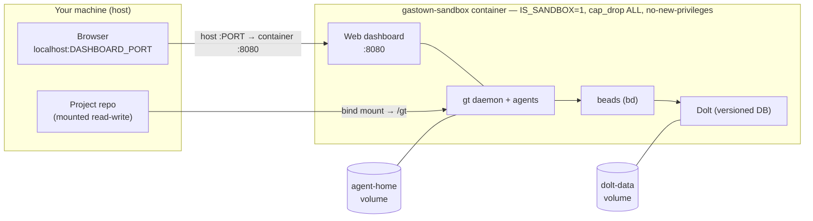

# Gastown Docker Sandbox

An isolated [Gas Town](https://github.com/steveyegge/gastown) environment for a
project. Your repo is mounted into a container where Gastown's agents run, so they
have a **safe place to work** — the container drops all Linux capabilities, runs
with `no-new-privileges` and `IS_SANDBOX=1`, and can only touch the project
mounted at `/gt`, not the rest of your machine.

This is **opt-in**. Enable it per project in `harness.toml`:

```toml
[targets.gastown]
docker_env = true
```

Then `harness build` writes the sandbox under `.gastown/docker/` (it never touches
an existing `docker-compose.yaml` in your project root).

## Architecture



- **Bind mount**: the project root → `/gt` (edits inside the container appear on
  the host and vice-versa).
- **Named volumes**: `agent-home` (the agent user's home) and `dolt-data` (the
  beads/Dolt database) persist across restarts.
- **Port**: host `DASHBOARD_PORT` (default `8080`) → container `8080`.

## Files (under `.gastown/docker/`)

| File | Owner | Notes |
|------|-------|-------|
| `docker-compose.yml` | harness | Regenerated each build — **don't edit**. |
| `Dockerfile` | harness | Builds Gastown from source at `GASTOWN_REF`. Regenerated. |
| `docker-entrypoint.sh` | harness | Sets git identity from env. Regenerated. |
| `.env.example` | harness | Template for your `.env`. Regenerated. |
| `docker-compose.override.yml` | **you** | Created once, never overwritten — put project changes here. |

## Quickstart

```sh
cd .gastown/docker
cp .env.example .env          # set GIT_USER, GIT_EMAIL, FOLDER, DASHBOARD_PORT, GASTOWN_REF

# Build + start (override is merged on top of the base):
docker compose -f docker-compose.yml -f docker-compose.override.yml build
docker compose -f docker-compose.yml -f docker-compose.override.yml up -d

# Get a shell in the sandbox:
docker compose -f docker-compose.yml -f docker-compose.override.yml exec gastown zsh

# Inside the container:
gt up
gh auth login        # optional, so gh works
gt mayor attach
```

> Tip: set `export COMPOSE_FILE=docker-compose.yml:docker-compose.override.yml`
> once in your shell and drop the repeated `-f` flags.

## Web dashboard

Gastown ships a single-page **web dashboard** that auto-refreshes (htmx) and gives
you a live view of the whole workspace:

- agents and their status (active / idle / stuck),
- convoys (batch work) with progress and a D3 dependency graph,
- hooks, queues, and the merge queue,
- beads / issues (browse and filter),
- agent mail/messaging and escalations,
- a command palette to run `gt` commands from the browser.

Start it **inside the container**, binding to all interfaces so the published port
is reachable from the host (the dashboard defaults to `127.0.0.1`, which is *not*
reachable through the published port):

```sh
gt dashboard --bind 0.0.0.0 --port 8080      # add --open to launch a browser
```

Then open `http://localhost:8080` (or your `DASHBOARD_PORT`) in a browser. It
shows convoy status with progress and activity indicators and auto-refreshes
every 30s (htmx).

Notes:
- Use `--bind 0.0.0.0` — the default `127.0.0.1` won't be reachable from the host.
- `DASHBOARD_PORT` in `.env` remaps the **host** port; the container side stays
  `8080` (matching the compose `ports:` mapping).
- Verify flags with `gt dashboard --help` (they can change across Gastown versions).

## Customizing

Edit `docker-compose.override.yml` (yours to keep) — add env vars, extra mounts,
or ports. It merges on top of the base, so you keep getting base improvements on
`harness build` while your changes persist. To change the whole base for **every**
project, edit the toolkit's `assets/gastown-docker/` source.

Pin the Gastown version by setting `GASTOWN_REF` in `.env` to a tag from
<https://github.com/steveyegge/gastown/tags>, then rebuild.

## Git ignore (in the target project)

Ignore the regenerated, harness-owned files; commit your override:

```gitignore
.gastown/docker/docker-compose.yml
.gastown/docker/Dockerfile
.gastown/docker/docker-entrypoint.sh
.gastown/docker/.env.example
.gastown/docker/.env
# keep: .gastown/docker/docker-compose.override.yml
```

> On container start the entrypoint configures git/dolt identity and runs
> `gt install /gt` to initialize (or refresh) the Gas Town workspace in your
> project automatically — so after `up -d` you can `exec` in and go straight to
> `gt up` / `gt mayor attach`.

## Caveats (honest)

- **Verified** to build and run against Gastown `@main` on 2026-06-07 with Docker
  28.5 (`gt v1.2.1`, `bd 1.0.4`, `dolt 2.0.7`, project mounted at `/gt`). It is
  still **not exercised in CI** (no Docker there), and Gastown is experimental —
  pin `GASTOWN_REF` and re-verify when you bump it.
- The `Dockerfile` mirrors upstream's (swapping a `git clone` for their `COPY`);
  keep it in sync if Gastown changes its own Dockerfile. The base image
  `docker/sandbox-templates:claude-code` and `gt`/dashboard commands are
  upstream-defined and may change.
